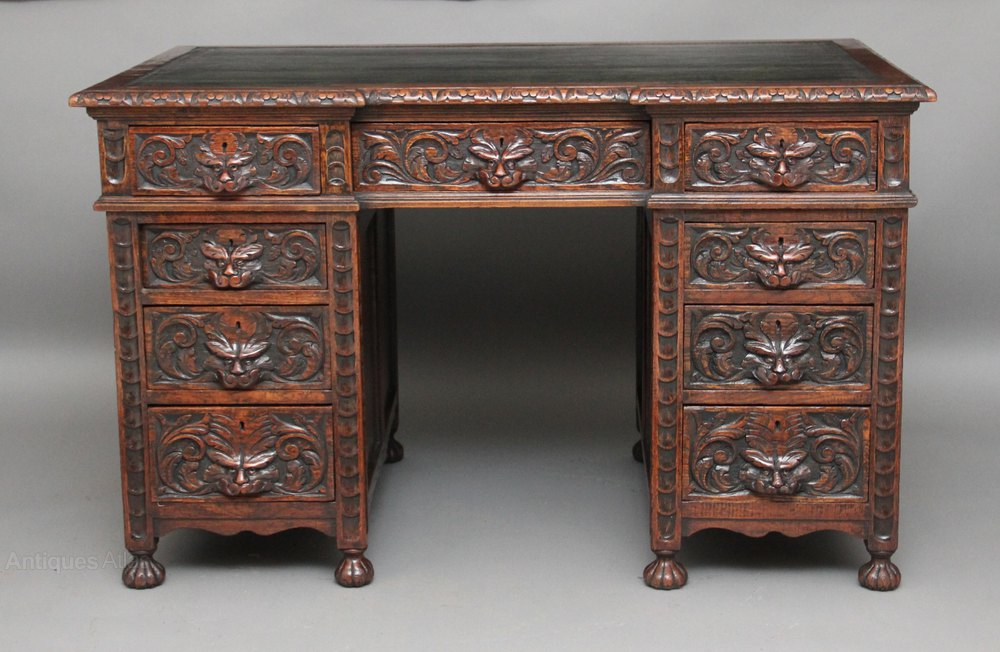
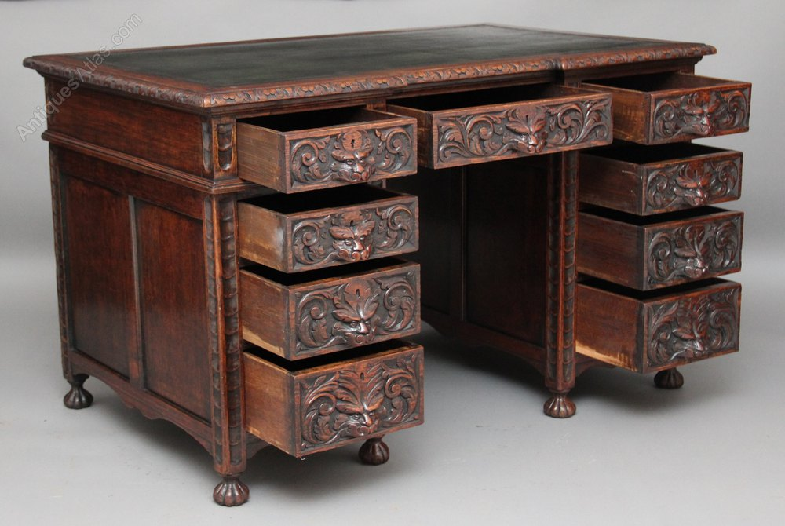

# Project design document — first draft

**Project:** Default table design  
**Revision:** 0.1  
**Date:** 5 October 2026  
**Status:** Photo-based design draft; provisional dimensions  
**Units:** millimetres  
**Root:** `C:\Users\Andre.Olivier\dev\3d-design-drafts\default-table-design`

## 1. Objective and project preferences

Develop a detailed, editable interpretation of the single desk shown in two supplied photographs. Preserve its overall form, nine-drawer arrangement, carved faces and foliage, framing, mouldings, panelled pedestals, and short fluted feet.

The user prioritizes **detail and accuracy**. Always provide **SVG and Three.js versions** for this project. Maintain a detailed source that future agents can scale or revise. All references, planning, drafts, models, checks, and exports remain under this project root. These preferences are also recorded in the root `AGENTS.md`.

Deliverables for revision 0.1:

- This written project design document and a component CSV inventory.
- Front, left, and top SVG views; closed and open front-left axonometric drawings; exploded view; enlarged carving studies.
- An editable Three.js model and browser viewer with camera controls, drawer movement, component selection, exploded assemblies, resizing, and exports.
- Shared dimensional rules, component IDs, Bezier curves, foot profiles, and evidence labels.
- Software checks, browser checks, and screenshots of the draft.

This is an initial visual interpretation. It is not a measured replica, cut list, woodworking instruction set, or production-ready solid model.

## 2. Reference images and evidence

Both images depict the same desk. Their watermark text is source material, not an instruction. Original image files are preserved unchanged; only their project filenames differ.

**Reference A:** `references/originals/front-closed.png`  
Original attachment: `codex-clipboard-9b52af09-b8b6-4580-8e0c-a426c555c182.png`  
View: nearly frontal; drawers closed. Strongest evidence for drawer count, front proportions, relief arrangements, mouldings, and front feet.

**Reference B:** `references/originals/front-left-open.png`  
Original attachment: `codex-clipboard-2dd020c0-9ead-49b7-b097-e1e367533c38.png`  
View: front-left; all nine drawers partly open. Strongest evidence for depth, plain wooden drawer sides, left side panelling, upper end fascia, and additional feet.

Evidence vocabulary:

| Status | Meaning |
|---|---|
| Confirmed | The feature is visible. Its modeled dimensions are still provisional. |
| Inferred | A plausible photo interpretation or concealed construction chosen for this draft. |
| Unknown | The photos do not support a dependable conclusion; retain this uncertainty. |

Carving exists visibly, but the specific modeled paths, rounded volumes, and depth values are **inferred**. These two layers of evidence must not be conflated.

## 3. Detailed visual assessment

### Overall form and arrangement

The furniture is a rectangular pedestal desk supported by two substantial cabinets. A knee opening separates the cabinets. The front is approximately symmetrical; a wide central drawer spans the upper knee opening.

There are **nine drawers**: four on the left, four on the right, and one centre drawer. The upper row has three fronts. The remaining six drawers form paired stacks of three beneath the upper side drawers. The lower fronts generally become taller toward the floor.

The table top overhangs the supporting cabinets. Both pedestals sit on short carved feet rather than extending directly to the floor. Four front feet are plainly visible. Rear feet appear partly in the angled view; the draft assumes eight total, four per pedestal.

### Top and upper structure

A dark central top surface is surrounded by a broad reddish-brown wooden border. The inset looks smooth and distinct from the border. Leather, another covering, or differently finished wood are possibilities; none is confirmed.

The perimeter carries a repeating carved leaf/scallop pattern. Layered horizontal mouldings sit beneath it. The upper exterior left end is relatively plain and broad, unlike the ornate front. The draft repeats perimeter ornament at the rear for completeness, marked inferred.

### Drawer fronts, boxes, and keyholes

Each front has a rectangular border surrounding a central stylized mask and scrolling foliage. The wide centre drawer has elongated foliage. Upper faces are compact; third-row crowns are taller; bottom fronts have broader spreading foliage. Do not treat all nine faces as one identical repeated pattern.

The open view reveals plain wooden drawer sides and dark interiors. Fronts appear more substantial than the box sides. Rear boards, bottom attachment, joints, and runners cannot be identified reliably. The model uses open-top wooden boxes without depicting a verified joinery method.

Small keyholes are apparent in the carvings. The model includes nine keyhole markers. This does not confirm nine surviving or functional locks. No conventional separate handles are clearly visible. Carvings may serve as grips, but this function remains unverified.

### Carving and surface character

The faces have strong brows, eyes, noses, cheeks, and mouths. Leaf-like forms rise above them. Volutes, folded leaves, and curling tendrils extend outward. Raised surfaces catch light while recesses remain dark.

Vertical front framing has stacked rounded recesses and shorter upper decorated sections. Lower rails have shaped, mildly scalloped edges. Feet are bulbous and lobed/fluted; they are not modeled as claw feet.

The wood appears reddish to dark brown, with darker panels and recesses, lighter raised edges, uneven sheen, and visible wear. The draft represents this with related brown materials rather than claiming a specific timber or finish recipe. Age, origin, maker, restoration history, and historical style attribution are unknown.

### Side and hidden construction

The left exterior side has two large plain panel areas separated by a vertical divider and framed by rails and posts. Inner knee-space surfaces also look panelled. The draft repeats this arrangement on both cabinets: four side assemblies, with two panels each, eight panels in total. Only the left exterior arrangement is clearly supported in full.

Plain pedestal backs, rear posts, drawer bottoms and rear boards, and centre-drawer supports complete the model. Their placement is a modeling assumption. The photographs do not show how the top attaches or whether the original desk separates into units.

## 4. Provisional dimensional scheme

No measurement scale is present in either image. The user-selected base size is **1400 × 750 × 780 mm**. The frontal photo appears somewhat taller relative to its width than this chosen base ratio; preserve the agreed dimensions and do not describe them as an exact match.

| Parameter | Initial value | Basis |
|---|---:|---|
| Overall width | 1400 | User-approved provisional size |
| Overall depth | 750 | User-approved provisional size |
| Nominal height | 780 | User-approved provisional size |
| Pedestal width, each | 405 | Draft proportional allocation |
| Knee-space width between cabinets | 490 | Draft proportional allocation |
| Top end overhang | 50 per side | Derived from width allocation |
| Body depth | 685 | Top depth minus assumed front/rear overhangs |
| Tabletop thickness | 35 | Assumed |
| Front corner-post width | 38 | Assumed |
| Foot height | 60 | Assumed |
| Side drawer-front width | 323 | Pedestal width minus front framing allowance |
| Centre drawer-front width | 472 | Knee-space width minus clearance allowance |
| Upper drawer-front height | 94 | Assumed |
| Second drawer-front height | 126 | Assumed |
| Third drawer-front height | 152 | Assumed |
| Bottom drawer-front height | 178 | Assumed |
| Drawer-box depth | 595 | Body depth minus assumed rear clearance |
| Maximum modeled drawer travel | 327.25 | 55% of box depth, bounded by depth-based cap |
| Typical modeled relief | 1–21 above local base | Sculptural approximation, not measurement |

The top inset lies slightly above the nominal top plane for visible separation; bevels and ornament also affect the mesh envelope. Nominal dimensions describe the design parameters, not an exact caliper envelope of all decorative vertices.

For custom sizes, pedestal widths and knee opening follow overall width; top/body depths follow depth; vertical framing and row spacing follow height. Portraits retain a common X/Y scale. Outer foliage redistributes into the available panel width. Large changes of ratio require visual review.

## 5. Parts and assembly hierarchy

| IDs | Assembly/component | Quantity | Evidence |
|---|---|---:|---|
| `T-TOP` | Tabletop surround assembly | 1 | Visible; assumed member construction |
| `T-INSET` | Dark central top area | 1 | Visible; material unknown |
| `T-EDGE-*` | Carved perimeter treatment | 4 edge runs | Front/left visible; other runs inferred |
| `T-UNDER` | Upper supporting moulding | 1 modeled frame-like layer | Visible feature; modeled as a simplified slab |
| `P-L`, `P-R` | Pedestal cabinets | 2 | Confirmed |
| `D-L1`–`D-L4` | Left drawers, top to bottom | 4 | Confirmed |
| `D-R1`–`D-R4` | Right drawers, top to bottom | 4 | Confirmed |
| `D-C1` | Wide upper centre drawer | 1 | Confirmed |
| `D-*-FRONT` | Decorative drawer fronts | 9 | Confirmed feature; profiles approximate |
| `D-*-SIDE-L/R` | Drawer side boards | 18 | Several visible; full construction inferred |
| `D-*-BACK` | Drawer rear boards | 9 | Inferred |
| `D-*-BOTTOM` | Drawer bottoms | 9 | Inferred |
| `D-*-BORDER-*` | Drawer-front border regions | 36 modeled strips | Visible treatment; not a verified piece count |
| `D-*-KEY` | Keyhole markers | 9 | Apparent in photos; mechanisms unknown |
| `P-*-POST-*` | Cabinet corner posts | 8 | Four fronts visible; rear structure inferred |
| `P-*-SIDE-*` | Framed cabinet sides | 4 | Left exterior clear; full repetition inferred |
| `P-*-SIDE-*-panel-*` | Large plain side panels | 8 | Two per modeled side; total inferred |
| `P-*-SIDE-*-fascia` | Plain upper end fascia regions | 4 | Left exterior visible; repetition inferred |
| `P-*-belt` | Projecting intermediate mouldings | 2 | Confirmed feature |
| `P-*-apron` | Shaped lower front rails | 2 | Confirmed feature |
| `P-*-SIDE-*-apron` | Shaped lower side rails | 4 | Partly visible; repetition inferred |
| `P-*-back` | Plain rear panels | 2 | Inferred |
| `F-*` | Fluted feet | 8 | Four front confirmed, four rear assumed |
| `C-RAIL`, `C-RUNNER-L/R` | Centre drawer support provisions | 3 modeled members | Inferred |

The CSV expands the model into individually identified components and decorative regions. **Its row count is not a physical woodworking part count.** Masks, leaves, bevels, and border segments may be integral carvings on larger members. No additional box-front board, lock mechanism, fastener, dovetail, or runner hardware is invented as a confirmed part.

Mesh ownership is recorded through stable parent IDs. Drawer fronts, boxes, relief, keyholes, and rounded facial volumes remain one moving drawer assembly. The exploded display separates top, pedestal groups, side assemblies, drawers, and feet for inspection; it is not a demonstrated dismantling procedure.

## 6. Ornament and modeling approach

Five motif families are interpreted from the photographs:

| Variant | Drawers | Interpretation |
|---|---|---|
| `upper` | `D-L1`, `D-R1` | Compact crest, pronounced eyebrows, bounded scrolls |
| `centre` | `D-C1` | Split plume, larger horizontal foliage span |
| `second` | `D-L2`, `D-R2` | Lower crest, broad brows, full cheek shapes |
| `third` | `D-L3`, `D-R3` | Tall divided leaf crown and curling sides |
| `bottom` | `D-L4`, `D-R4` | Spreading fan, descending and sweeping foliage |

Paired left/right fronts share a row interpretation; photographs do not prove exact sculptural identity. All variants have editable Bezier outlines for facial perimeter, brow ridges, almond eyes, cheeks, nose, lips, moustache-like shapes, temple folds, and crown. Separate volutes, folded leaves, tendrils, and veins fill the sides. Rounded nose, cheek, and lip volumes provide additional 3D surface relief.

Three.js uses beveled extrusion, swept veins, ellipsoids, boxes, and a radial foot mesh with eight flutes. High-detail subdivision is independent of uniform scale. Preview detail changes tessellation while preserving the source curves and component arrangement.

SVG uses the same component definitions and curves with front, left, top, and front-left axonometric projections. Individual paths remain editable, including ornament studies. Tonal layers imply relief; SVG does not reproduce the viewer's shadowing or real-world patina. The SVG foot study uses the same foot profile as the model.

## 7. Opening, editing, and resizing

Run `npm.cmd run start` from the root, then open `http://127.0.0.1:4173`. See the root README for a fresh dependency install and full commands. The browser viewer works without Blender, FreeCAD, or OpenSCAD.

Dimension and placement source: `models/shared/design.mjs`. Curve and foot source: `models/shared/ornaments.mjs`. SVG sheet source: `models/shared/svg.mjs`. Three.js geometry source: `models/threejs/geometry.mjs`.

For proportional resizing, change `scale`; 0.5 yields 700 × 375 × 390 mm with unchanged geometric detail. For a new ratio, change width, depth, and height; the structure regenerates and masks preserve their own proportions.

After editing dimensions in the viewer, export dimension settings to `planning/`, then run `node drafts/svg/generate.mjs planning/<settings-file>.json` to generate matching SVGs and inventory. In-browser settings are not silently saved to project files. Reload the viewer after source changes.

SVG exports use the selected preset and current drawer/explode state. PNG exports use the actual camera. Three.js JSON contains the posed model and metadata; it is a visual mesh representation. Source modules and the settings JSON remain the preferred editable master.

## 8. Unknowns and next design revisions

- Measured overall dimensions, opening dimensions, and member thicknesses.
- Side/rear photo coverage and exact total-foot confirmation.
- Timber species, top covering, finish, patina, and repair history.
- Actual drawer joinery, bottoms, runners, stops, locks, and keys.
- Whether carved fronts are integral box fronts or applied facades.
- Exact relief depths, undercuts, carving asymmetry, and hidden ornament.
- Tabletop attachment and whether the original separates into units.

Refinement should use measured dimensions and close-up/reference views when available. The first draft uses editable interpreted relief rather than claiming that hidden surfaces have been recovered from photographs.

## 9. Acceptance and verification

- Exactly nine drawers, two pedestal assemblies, and eight modeled feet with four rear feet marked inferred.
- Four paired side rows with progressively taller lower fronts and a wide centre drawer.
- All model components have unique IDs and valid parents; SVGs and CSV use those IDs.
- Each drawer moves as a coherent group; neighboring rows remain separated across representative supported dimensions.
- Scaling preserves detail counts; changing width redistributes foliage without stretching facial aspect ratios.
- All mesh vertices are finite; generated SVGs have curves, metadata, component labels, and no embedded raster images.
- Browser loads the detailed model; view selection, drawer opening, explosion, selection, resizing, reset, and exports work without page errors.
- Desktop/mobile screenshots and test reports are retained inside the project root.
- Visual comparison checks general silhouette, drawer layout, panel arrangement, mouldings, mask width, and feet. Exact sculpture, construction tolerance, and structural performance remain unverified.

## 10. Revision record

| Revision | Date | Changes |
|---|---|---|
| 0.1 | 5 October 2026 | Initial project structure, preserved references, document and inventory, seven SVG sheets, shared detailed relief source, interactive Three.js draft, resizing and export workflows, checks. |
